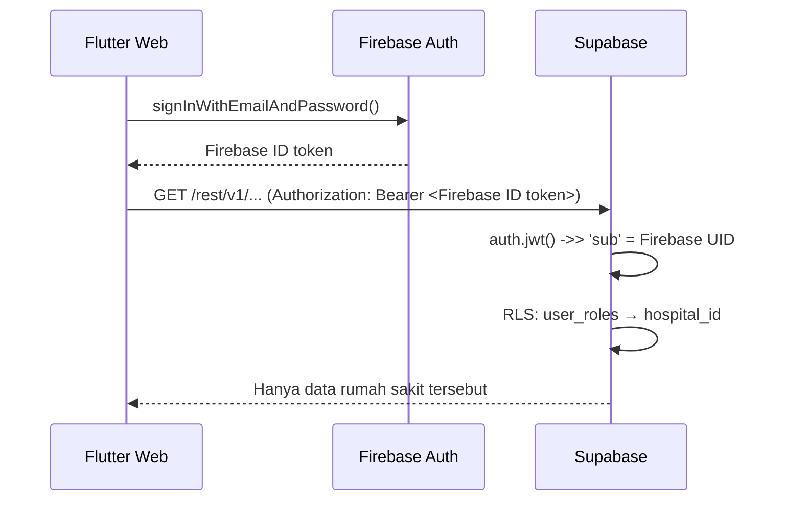
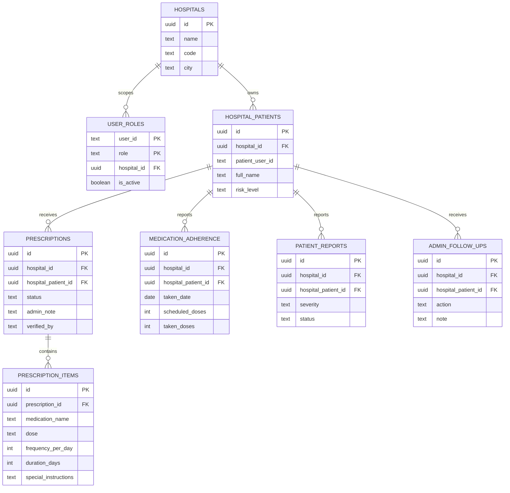

# Web Dashboard Admin Rumah Sakit (`hospital_admin`)

Modul ini **hanya menambahkan** role dan antarmuka baru. Kode pasien, dokter, dan
aplikasi mobile tidak diubah alurnya.

| Bagian | Lokasi |
|---|---|
| Skema + RLS + RPC + seed | `supabase/03_hospital_admin_rbac.sql` |
| Model data | `lib/data/models/hospital_admin.dart` |
| Repository (query & mutation) | `lib/data/repositories/hospital_admin_repository.dart` |
| UI (sidebar, halaman, modal) | `lib/features/hospital_admin/` |
| Route | `/hospital-admin/dashboard`, `/hospital-admin/medications`, `/hospital-admin/patients` |
| Guard | `lib/features/hospital_admin/presentation/guards/hospital_admin_guard.dart` |
| Uji | `test/hospital_admin_test.dart` |

---

## 1. Fitur

1. **Ringkasan Dashboard**
   - Total pasien aktif pasca rawat inap
   - Resep menunggu verifikasi
   - Tingkat kepatuhan minum obat (%)
   - Peringatan risiko tinggi
   - Daftar resep yang menunggu tindakan + peringatan terbaru + kepatuhan terendah
2. **Verifikasi Obat**
   - Daftar resep dengan filter status: menunggu verifikasi, butuh klarifikasi,
     terverifikasi
   - Modal verifikasi berisi form dinamis: nama obat, dosis, frekuensi harian,
     durasi hari, dan instruksi khusus
   - Aksi **Verifikasi & Terbitkan Jadwal** (status `verified`) dan
     **Minta Klarifikasi ke Dokter** (status `needs_clarification`)
3. **Pemantauan Pasien**
   - Tabel pasien, dokter penanggung jawab, skor kepatuhan, dan status obat
   - Indikator real-time untuk dosis terlewat dan keluhan pasien
     (Supabase Realtime + polling cadangan 30 detik)
   - Modal **Catat Tindak Lanjut**; laporan keluhan terkait otomatis ditutup

### Indikator warna

| Warna | Makna |
|---|---|
| Hijau | Terverifikasi / patuh / aman |
| Kuning | Menunggu verifikasi / risiko sedang |
| Merah | Dosis terlewat / risiko tinggi / keluhan |
| Biru | Informasi & permintaan klarifikasi |

---

## 2. Arsitektur otentikasi



- Supabase dikonfigurasi memakai **Third-Party Auth → Firebase**, sehingga
  `auth.jwt()` berisi klaim Firebase dan `sub` adalah Firebase UID.
- `SupabaseConfig.firebaseAuthClient` membuat `SupabaseClient` dengan opsi
  `accessToken`, yang selalu mengambil token terbaru lewat
  `FirebaseAuth.currentUser?.getIdToken()`. Client utama (`SupabaseConfig.client`)
  tidak diubah agar modul pasien/dokter tetap berjalan seperti sebelumnya.
- `user_roles` menyimpan `user_id` (Firebase UID), `role`, dan `hospital_id`.

---

## 3. Setup Supabase

### 3.1 Jalankan SQL

Jalankan berurutan di SQL Editor Supabase:

1. `supabase/01_medication_doctor_chat.sql`
2. `supabase/02_profiles_auth_sync.sql`
3. `supabase/03_hospital_admin_rbac.sql`

File ketiga bersifat idempoten (`create table if not exists`, `drop policy if exists`,
`on conflict do nothing`), sehingga aman dijalankan ulang.

### 3.2 Aktifkan Firebase sebagai third-party auth

Supabase Dashboard → **Authentication → Third-Party Auth → Add provider → Firebase**,
lalu isi **Firebase Project ID**.

Tanpa langkah ini semua policy akan menolak akses (anon tidak diberi izin).

### 3.3 Daftarkan admin

1. Buat akun admin di **Firebase Console → Authentication → Users**.
2. Di **Firestore**, buat/ubah dokumen `users/{uid}` dan set:
   ```json
   { "role": "hospital_admin" }
   ```
   (Aplikasi membaca role dari Firestore; lihat `AuthRepository.parseRole`.)
3. Daftarkan UID tersebut pada tabel `user_roles`:
   ```sql
   insert into public.user_roles (user_id, role, hospital_id)
   values ('<FIREBASE_UID_ADMIN>', 'hospital_admin',
           'a1000000-0000-4000-8000-000000000001')
   on conflict (user_id, role) do update
     set hospital_id = excluded.hospital_id, is_active = true;
   ```
4. Ganti placeholder `GANTI_DENGAN_FIREBASE_UID_ADMIN` pada seed file SQL agar
   contoh tindak lanjut/resep terhubung ke admin yang benar.

### 3.4 Kredensial client

Isi `.env` di root project:

```env
SUPABASE_URL=https://xxxx.supabase.co
SUPABASE_ANON_KEY=eyJhbGciOi...
```

Bila `.env` kosong, dashboard otomatis memakai **data demo lokal** dan menampilkan
badge “Data demo”.

---

## 4. Skema data



### Query yang dipakai dashboard

| Kebutuhan | Sumber |
|---|---|
| Kartu ringkasan | RPC `hospital_admin_summary()` |
| Daftar resep | `prescriptions` + embed `hospital_patients` & `prescription_items` |
| Daftar pasien | View `hospital_patient_monitoring` |
| Peringatan aktif | View `hospital_alerts` |
| Verifikasi resep | RPC `hospital_verify_prescription(uuid, jsonb, text)` |
| Minta klarifikasi | RPC `hospital_request_clarification(uuid, text)` |
| Tindak lanjut | RPC `hospital_record_follow_up(uuid, text, text, uuid, uuid)` |
| Realtime | `postgres_changes` pada `medication_adherence` & `patient_reports` (filter `hospital_id`) |

---

## 5. Matriks RLS

Semua policy memakai role `authenticated` (JWT Firebase valid).

| Tabel | SELECT | INSERT/UPDATE/DELETE |
|---|---|---|
| `hospitals` | hanya rumah sakit milik admin | tidak (provisioning server) |
| `user_roles` | role sendiri + staf rumah sakit sendiri | tidak (provisioning server) |
| `hospital_patients` | `hospital_id = current_hospital_id()` | idem |
| `prescriptions` | idem | idem |
| `prescription_items` | via parent `prescriptions` | idem |
| `medication_adherence` | idem | idem |
| `patient_reports` | idem | idem |
| `admin_follow_ups` | idem | idem |

`app.current_hospital_id()` adalah fungsi `SECURITY DEFINER` yang membaca
`user_roles` berdasarkan `auth.jwt() ->> 'sub'`, sehingga tidak terjadi rekursi RLS.
Role `super_admin` (bila ada) dapat membaca seluruh rumah sakit.

---

## 6. Navigasi & guard berlapis

1. **Router** (`lib/core/routing/app_router.dart`):
   - Role `hospital_admin` yang membuka `/patient/*` atau `/doctor/*` diarahkan ke
     `/hospital-admin/dashboard`.
   - Role lain yang membuka `/hospital-admin/*` diarahkan ke dashboard miliknya.
2. **UI guard** (`HospitalAdminGuard`): memeriksa ulang `AuthRepository.currentUser`
   sebelum merender shell admin; bila bukan admin, tampil halaman “Akses Ditolak”.
3. **Supabase RLS**: batas data sebenarnya. Meskipun UI dilewati, query tetap
   dibatasi `hospital_id` milik admin.

---

## 7. Menjalankan

```bash
flutter run -d chrome --web-port 8080
```

Lalu login dengan akun `hospital_admin` → otomatis diarahkan ke
`/hospital-admin/dashboard`.

### Prasyarat Firebase Web

Di Android/iOS, `Firebase.initializeApp()` memakai `google-services.json` /
`GoogleService-Info.plist`. Di **web**, Firebase membutuhkan opsi eksplisit.
Tambahkan konfigurasi Web App Firebase ke `.env` (lihat
`_firebaseWebOptions()` di `lib/main.dart`):

```env
FIREBASE_WEB_API_KEY=AIza...
FIREBASE_WEB_APP_ID=1:1234567890:web:abcdef
FIREBASE_WEB_MESSAGING_SENDER_ID=1234567890
FIREBASE_WEB_PROJECT_ID=nama-project
FIREBASE_WEB_AUTH_DOMAIN=nama-project.firebaseapp.com
FIREBASE_WEB_STORAGE_BUCKET=nama-project.appspot.com
```

Nilainya diambil dari Firebase Console → **Project settings → Your apps → Web app**
(setelah web app didaftarkan). Tanpa konfigurasi ini dashboard web tetap bisa
dibuild, tetapi login Firebase akan gagal. Alternatifnya, jalankan
`flutterfire configure` lalu inisialisasi dengan `DefaultFirebaseOptions`.

> Catatan: bila `.env` Supabase kosong, repository admin memakai data demo lokal,
> namun akses ke route tetap mensyaratkan login Firebase + role
> `hospital_admin`. Ini disengaja agar RBAC tidak bisa dilewati.

---

## 8. Uji

```bash
flutter test test/hospital_admin_test.dart
```

Mencakup:

- parsing role `hospital_admin` (termasuk alias) dan serialisasi `hospital_admin`
- mapping model resep/pasien dari row Supabase
- alur demo: ringkasan, verifikasi, klarifikasi, tindak lanjut, stream peringatan
- widget: empat kartu ringkasan dan penolakan akses guard

---

## 9. Integrasi dengan modul lain

- **Dokter** (mobile): membuat baris `prescriptions` dengan status
  `pending_verification` dan item awal (opsional). Admin dapat memperbaiki item
  saat verifikasi.
- **Pasien** (mobile): menulis rekap harian ke `medication_adherence` dan keluhan ke
  `patient_reports`. Kedua tabel sudah ditambahkan ke publication
  `supabase_realtime`.
- **Admin**: hanya membaca/menulis tabel di atas sesuai `hospital_id`.

Tidak ada perubahan pada repository/model pasien maupun dokter yang sudah ada.
